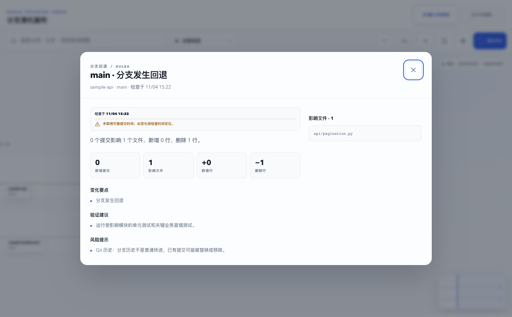

# Branch Radar

English · [简体中文](README.md)

Branch Radar is a local-first Git branch radar. It scans repositories already on your machine and can also clone a GitHub project after you explicitly confirm its destination. It then identifies remotes and branches, keeps track of how those branches move, and can turn each change into a structured summary using your existing Codex CLI login — then file it into a Lark/Feishu document through your configured `lark-cli`.

It never stores Git, Codex, or Lark credentials, and never modifies the working tree of a monitored repository.

The default entry point is a console that runs only on your own machine: it opens a browser on start, asks you to choose one or more local scan roots through the system folder picker, and then walks you through picking the projects and branches you actually care about. The CLI remains available for scripting, Codex CLI, and advanced operations.



## What it does today

- A responsive local web console with a change inbox, watched branches, and progressive settings for advanced integrations.
- Installs as a user-level background service (launchd / systemd) so monitoring survives closing the terminal.
- Observation is pluggable through a `FactSource`; local checkouts are the current implementation, and a server-side mirror or forge webhook can be added alongside it.
- After you choose scan roots, repositories, and branches, it adopts them as a silent baseline so existing history is never reported as new.
- Background jobs survive page reloads; only one scan, check, or publish runs at a time.
- Discovers Git repositories and worktrees under any local directories you explicitly choose.
- A pasted GitHub URL first matches existing checkouts; when none exists, you can choose a scan root, clone the project, and continue directly to branch selection without giving Branch Radar a GitHub credential.
- The Web console uses the native system folder picker as its primary path; manual entry stays collapsed as a headless-environment fallback.
- New scan roots inside HOME are stored as `~/…` for portability; existing absolute-path configurations remain compatible.
- Detects and redacts remote URLs, current branches, and remote-tracking branches.
- Detects fast-forwards, force pushes, rewinds, branch deletion, and recreation.
- Distinguishes Git authors, committers, merge commits, and actual contributors.
- Classifies API, database, config, dependency, deployment, and test changes with deterministic rules.
- Optionally calls `codex exec` with a read-only, ephemeral session and a JSON schema.
- Detects an existing `lark-cli` login; creates a project document or appends a changelog.
- Every core command supports `--json` for Codex CLI and other automation.
- The Web console switches instantly between Simplified Chinese and English and remembers the browser's language preference.

## Quick start

No third-party Python packages are required. Python 3.10+.

```bash
git clone https://github.com/ZYB10/branch-radar-oss.git
cd branch-radar-oss
python3 -m venv .venv
.venv/bin/pip install -e .

.venv/bin/branch-radar web
```

The console listens on `http://127.0.0.1:8765` and opens a secure page carrying a one-shot session fragment. Closing the terminal or pressing `Ctrl-C` stops it. To start without opening a browser:

```bash
.venv/bin/branch-radar web --no-open
```

`--no-open` prints a launch-specific secure link. Use that link — typing the base address alone will not authenticate you.

### Keeping it running

A foreground process dies with its terminal. Install it as a user-level background service:

```bash
.venv/bin/branch-radar service install --dry-run    # inspect the unit first
.venv/bin/branch-radar service install --interval 900
.venv/bin/branch-radar service status
```

macOS writes `~/Library/LaunchAgents/com.branch-radar.agent.plist`; Linux writes to `~/.config/systemd/user/`.
The unit pins the interpreter used at install time, the current `PATH`, and `BRANCH_RADAR_HOME` — without those, the background process cannot find `git` / `lark-cli`, or would silently use a different state directory.
`--publish` means every polling round writes to your Lark document, so a document must already be linked before installing with it.

The CLI flow still works on its own:

```bash
.venv/bin/branch-radar doctor
.venv/bin/branch-radar init --root ~/projects
.venv/bin/branch-radar check
.venv/bin/branch-radar events
```

`uv` works too:

```bash
uv venv
uv pip install -e .
uv run branch-radar web
```

After the first PyPI release, `uvx branch-radar web` will run the console without
cloning the repository. See [docs/releasing.md](docs/releasing.md) for the
Trusted Publishing release process.

The default state directory is `~/.branch-radar`. Override it for tests or multiple instances:

```bash
BRANCH_RADAR_HOME=/tmp/my-radar branch-radar doctor
```

The command line speaks Chinese and English. It follows `BRANCH_RADAR_LANG` or
the system locale, and a single run can be set explicitly:

```bash
branch-radar --lang en doctor
```

## Typical flow

### 1. Guided setup

```bash
branch-radar web
```

The console reads dependency status automatically. On first use, choose one or more scan roots through the native system folder picker; only saved directories are used for project discovery. You can also paste a GitHub repository URL: Branch Radar first looks for an existing checkout, and only runs a safe clone after you confirm the destination. A remote refresh and baseline only happen after you pick repositories and branches. Codex summaries and Lark publishing are off by default, and every GitHub download or external Lark write requires an explicit click.

For a terminal-only environment:

```bash
branch-radar init --root ~/projects
branch-radar discover ~/projects /Volumes/team-code
```

Repeat `init --root` to select multiple scan roots, or pass several arbitrary directories to `discover PATH...` for a one-off scan. New paths inside HOME are stored as `~/…`, so they are not tied to a username or HOME location; existing absolute paths are left compatible.

Initialization checks Git, Codex CLI, and lark-cli; scans the directories you specify; lets you select repositories by number; confirms branches per repository; reuses your existing Codex and Lark identities; and establishes a baseline without treating all past commits as new messages.

### 2. Check for changes

```bash
branch-radar check
branch-radar check --no-fetch
branch-radar check --codex
branch-radar check --publish
```

`check` fetches only the branches currently being watched and uses `--no-tags`. It updates explicit remote-tracking refs only — it never switches branches or overwrites local files. It safely removes a watched tracking ref when that branch disappears upstream, ignores repository-specific fetch refspecs, and disables recursive submodules, tag pruning, and auto maintenance.

### 3. Configure the Lark document

```bash
branch-radar lark status
branch-radar lark set-document 'https://example.feishu.cn/docx/xxx'
branch-radar lark create-document --title 'Branch activity'
branch-radar lark publish
```

Document writes use an explicit `--as user`. Branch Radar stores only the document URL/token and an identity summary; it never reads or copies a Lark access token.

### 4. Driving Branch Radar from Codex

```bash
branch-radar status --json
branch-radar events --json
branch-radar check --json --no-publish
```

Branch Radar hands Codex only precomputed Git facts and a trimmed diff, explicitly labeled as untrusted input. Codex runs in an ephemeral session with structured output and a `read-only` write policy; it never advances a branch cursor or decides delivery state.

`--codex` is an explicit choice: it may send trimmed, credential-filtered file paths and diffs to whatever model service your Codex CLI talks to. Branch Radar reuses your existing login but ignores user config, MCP, and project rules by default, and strips absolute local paths, remote URLs, emails, common secret assignments, and sensitive file bodies. Your organization's code and data policies still apply.

An important boundary: Codex CLI is a full local coding agent. Its `read-only` sandbox blocks writes; it is **not** an OS/chroot isolation that limits reads to the Branch Radar analysis directory. An untrusted commit message can still try to induce the agent to read other readable files on the machine. Branch Radar uses a private working directory, trims the process environment, and forbids tools and network in the prompt — but none of that is a hard security boundary. Use `--codex` only on repositories you trust; keep the default rule-based summaries for sensitive code.

## Command reference

```text
branch-radar init --root PATH             Interactive setup for a scan root; repeatable
branch-radar web                          Start the console and open a browser
branch-radar web --no-open                Start the console only
branch-radar discover PATH [PATH ...]     Scan one or more specified directories
branch-radar watch add PATH [--branch B]  Start watching
branch-radar watch add PATH --rebaseline  Explicitly rebind remote / rebuild baseline
branch-radar watch list                   Show the watch list
branch-radar watch remove WATCH_ID        Stop watching; preserve history and cursor
branch-radar check                        Fetch and detect changes
branch-radar status                       Overall state
branch-radar events                       Recent change events
branch-radar prune --before 90d --dry-run Preview expired history
branch-radar prune --before 90d --vacuum  Prune history and reclaim free pages
branch-radar doctor                       Diagnose dependencies, auth, state dir
branch-radar daemon --interval 900        Foreground polling loop
branch-radar service install              Install and start the background service
branch-radar service install --dry-run    Print the unit file without installing
branch-radar service status               Service state and log paths
branch-radar service uninstall            Stop and remove the background service
branch-radar lark status                  Check the Lark connection
branch-radar lark create-document         Create the activity document
branch-radar lark set-document DOC        Link an existing document
branch-radar lark publish                 Retry undelivered events
branch-radar codex status                 Check Codex CLI
```

`prune` removes only events older than the cutoff that have neither an unresolved delivery nor an unacknowledged actionable check run. Deliveries in `pending`, `retry`, `unknown`, or `inflight` state and events belonging to those check runs stay protected. Expired acknowledged or no-change check runs are pruned with their history. Preview with `--dry-run` first. Starting with this release, SQLite `user_version` guards the state schema so older binaries that support the guard reject databases created by newer versions.

## Security boundaries

- All external programs run as argv arrays, never through a shell.
- The web server binds `127.0.0.1` only. The session token lives in the launch link's URL fragment, so it never reaches an HTTP request or the page source; write endpoints additionally require a same-origin `Origin` and a JSON content type.
- No CORS, external Hosts rejected, and bounded request bodies, concurrent handlers, and background jobs.
- Remote URLs are stripped of HTTP usernames, passwords, and tokens before storage.
- The state directory is `0700` and the SQLite file `0600` on macOS/Linux.
- Codex ignores user config, MCP, and project rules by default and runs `read-only`. It is not a file-read isolation boundary.
- Raw diffs are read within a byte budget, in-process, only under an explicit `--codex`, and never written to SQLite. The database stores Git facts only.
- lark-cli writes use the user identity and are validated against a structured success envelope.
- After a successful Lark write, a stable event marker is searched back to reduce duplicate appends caused by an interrupted process.
- Automatic publishing backfills missing outbox rows every round, so an interrupted process can reconcile and retry.
- First-time setup establishes a baseline only; it never sends historical messages.
- GitHub cloning accepts only normalized HTTPS/SSH GitHub addresses, reuses the machine's existing Git credentials, and never prompts for or stores a token. It preserves complete commit history and remote branch refs while using a partial clone to defer old file contents that are not yet needed. Failure or cancellation cleans only the random staging directory created by that job; an incomplete cleanup is reported explicitly, and an existing destination is never overwritten.

## Current constraints

- The background service is a user-level agent (macOS LaunchAgent / systemd user unit) tied to your login session. On macOS that is also what lets lark-cli reach the Keychain, which is why no LaunchDaemon mode is offered.
- On Linux, surviving logout requires `loginctl enable-linger $USER`. That needs additional privileges, so Branch Radar will not run it for you.
- With `service install --mode web`, the `#session=` secure link is written only to the log file and must be read from there.
- One checkout may watch differently named branches on different remotes, but watching the same branch name on two remotes (`origin/main` and `upstream/main`) is not supported yet. A changed remote is safely refused and requires an explicit `watch add --rebaseline`.
- App-created partial clones preserve full ancestry, but an uncached old file version may require an on-demand network fetch the first time it is inspected. App-managed bare mirrors and long-term object retention are the next stage.
- `--codex` is for trusted repositories only. Environments needing hard read isolation should stay on the default rule-based summaries.

## Language

The Web console supports Simplified Chinese and English across navigation, forms, progress and error states, accessibility labels, dates, and the changelog. It follows the browser language on first use and persists an explicit choice locally. CLI output remains Simplified Chinese; JSON output is the stable language-neutral automation surface.

## Development

```bash
python3 -m unittest discover -s tests -v
ruff check .
mypy --platform=linux
mypy --platform=darwin
node --check src/branch_radar/resources/web/theme-bootstrap.js
node --check src/branch_radar/resources/web/app.js
node --check src/branch_radar/resources/web/ui-model.js
node --test tests/web_ui_model.test.js
uv build
```

See [docs/architecture.md](docs/architecture.md) for the architecture and event state model,
and [docs/releasing.md](docs/releasing.md) for maintainer release instructions.
