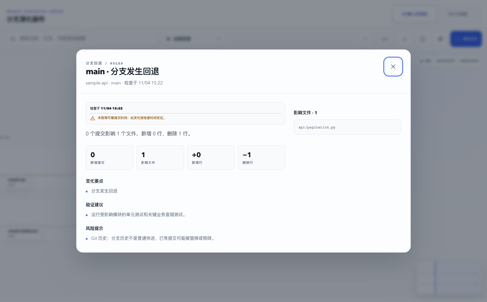

# Branch Radar

[English](https://github.com/ZYB10/branch-radar-oss/blob/main/README.en.md) · 简体中文

Branch Radar 是一个本地优先的 Git 分支雷达。它扫描电脑上已有的仓库，也可以在用户明确确认目录后从 GitHub 安全克隆项目；随后自动识别远程地址和当前分支，持续梳理分支变化，并可使用本机已经登录的 Codex CLI 生成结构化摘要，再通过已经配置好的 `lark-cli` 沉淀到飞书文档。

它不会保存 Git、Codex 或飞书的密钥，也不会修改被监控仓库的工作区文件。

默认入口是一个只在本机运行的可视化控制台：启动后会自动打开浏览器，首次进入通过系统文件夹选择器明确选择一个或多个本地扫描目录，再通过引导式界面选择真正需要关注的项目和分支。命令行仍保留给脚本、Codex CLI 与高级操作使用。



## 当前能力

- 提供响应式 Web 控制台：动态收件箱、关注分支和设置；高级能力按需展开。
- 可安装为 launchd / systemd 用户级定时任务：默认每 15 分钟唤醒一次、完成一轮有界检查后退出，空闲时不常驻 Python 进程，也不占用端口；支持 5 / 15 / 30 / 60 分钟间隔。
- 系统通知默认关闭；启用后只在一轮检查确认出现真实变化时发送一条合并提醒，并支持跨午夜的勿扰时段。
- 观察来源通过 `FactSource` 抽象接入；本地 checkout 是当前实现，服务端 mirror 或 webhook 可以并列接入。
- 明确选择扫描目录、仓库和分支后，以静默 baseline 接入，不把历史提交误报成新变化。
- 后台任务可跨页面恢复；同一时刻只执行一个扫描、检查或发布操作。
- 扫描用户明确选择的任意本地目录，发现其中的 Git 仓库与 worktree。
- 粘贴 GitHub 地址时优先匹配已有 checkout；不存在时可选择扫描目录、克隆项目并直接进入分支选择，全程不接收或保存 GitHub 凭据。
- Web 控制台以系统原生文件夹选择器为主入口；手动路径仅作为无图形环境下的折叠兜底。
- HOME 内的新扫描目录保存为 `~/…`，便于在不同机器上沿用；已有绝对路径配置继续兼容。
- 自动识别并脱敏远程 URL、当前分支和远程跟踪分支。
- 交互式初始化关注列表，并安静建立初始基线。
- 检测普通前进、强制推送、回退、分支删除和重新出现。
- 区分 Git 作者、提交者、合并提交与实际贡献者。
- 通过确定性规则识别 API、数据库、配置、依赖、部署和测试变化。
- 可选调用 `codex exec`，以只读、临时会话和 JSON Schema 生成摘要。
- 自动检测现有 `lark-cli` 登录；可创建飞书项目文档或追加变更日志。
- 所有核心命令支持 `--json`，便于 Codex CLI 或其他自动化调用。
- Web 控制台支持简体中文和英文即时切换，并在本机浏览器中记住语言偏好。

## 快速开始

项目不依赖第三方 Python 包，支持 Python 3.10+。

```bash
git clone https://github.com/ZYB10/branch-radar-oss.git
cd branch-radar-oss
python3 -m venv .venv
.venv/bin/pip install -e .

.venv/bin/branch-radar web
```

控制台默认监听 `http://127.0.0.1:8765`，并自动打开带临时会话片段的安全页面。关闭运行它的终端或按 `Ctrl-C` 即停止服务。若只想启动服务、不自动打开浏览器：

```bash
.venv/bin/branch-radar web --no-open
```

`--no-open` 会在终端打印本次启动专用的安全链接；请使用该链接进入，不要只手动输入基础地址。

### 让它一直运行

前台进程会随终端关闭而停止。装成用户级后台服务：

```bash
.venv/bin/branch-radar service install --dry-run    # 先看将写入什么
.venv/bin/branch-radar service install --interval 900
.venv/bin/branch-radar service status
```

默认间隔是 15 分钟；产品支持 5 / 15 / 30 / 60 分钟，可以在 Web 设置中选择，也可以分别用 `--interval 300`、`900`、`1800` 或 `3600` 安装。macOS 由 LaunchAgent 定时唤醒，Linux 由 systemd user timer 定时唤醒；每次只启动一次有界检查，完成后 Python 进程立即退出。两轮之间没有常驻 daemon，也不会监听任何端口。

这与 Web 控制台是两件事：`branch-radar web`（以及 `service install --mode web`）仍是常驻的本地服务，只监听 loopback 地址，供浏览器随时访问。定时检查本身不依赖 Web 端口持续打开。

macOS 写入 `~/Library/LaunchAgents/`，Linux 写入 `~/.config/systemd/user/`。
单元文件会固定安装时使用的 Python 解释器、当前 `PATH` 和 `BRANCH_RADAR_HOME`，否则后台进程会找不到 `git` / `lark-cli`，或者用错状态目录。
macOS 上即使后台 `PATH` 较精简，Branch Radar 也会有界探测 ChatGPT 应用包内置的 Codex CLI；其他自定义安装位置可通过 `codex.binary` 显式指定。
`--publish` 表示每轮检查都会自动写入飞书文档，安装前必须已关联文档。

系统通知同样在 Web 设置中管理，默认关闭。启用后，一轮检查无变化时保持安静；一个或多个关注分支出现真实变化时只发送一条合并通知。勿扰时段按本机时间判断，并支持例如 `22:00` 至次日 `08:00` 的跨午夜范围。

命令行流程也仍然可用：

```bash
.venv/bin/branch-radar doctor
.venv/bin/branch-radar init --root ~/projects
.venv/bin/branch-radar check
.venv/bin/branch-radar events
```

也可以使用本机的 `uv`：

```bash
cd branch-radar-oss
uv venv
uv pip install -e .
uv run branch-radar web
```

首个 PyPI 版本发布后，也可以不克隆仓库，直接运行
`uvx branch-radar web`。发布流程和 Trusted Publishing 配置见
[维护者发布说明](https://github.com/ZYB10/branch-radar-oss/blob/main/docs/releasing.md)。

默认数据目录是 `~/.branch-radar`。测试或多实例运行时可以覆盖：

```bash
BRANCH_RADAR_HOME=/tmp/my-radar branch-radar doctor
```

命令行支持中文和英文。默认跟随 `BRANCH_RADAR_LANG` 或系统区域设置，也可以按次指定：

```bash
branch-radar --lang en doctor
```

## 典型流程

### 1. 可视化初始化

```bash
branch-radar web
```

浏览器控制台会自动读取依赖状态。首次使用时先通过系统原生文件夹选择器明确选择一个或多个扫描目录；只有保存后的目录会用于项目发现。你也可以粘贴 GitHub 仓库地址：Branch Radar 会先匹配本机 checkout，找不到时在明确确认目标目录后执行安全 clone，成功后直接进入分支选择。选择仓库与分支后才会执行远程刷新并建立 baseline；Codex 深度总结和飞书发布默认关闭，任何 GitHub 下载或飞书外部写入都需要明确点击。

如需纯终端环境，也可以运行：

```bash
branch-radar init --root ~/projects
branch-radar discover ~/projects /Volumes/team-code
```

`init --root` 可重复传入，以选择多个扫描目录；`discover PATH...` 也可一次临时扫描多个任意目录。配置新的 HOME 内路径时会保存为 `~/…`，所以用户名或 HOME 位置变化不会把路径写死；已有绝对路径仍可继续读取。

初始化会：

1. 检查 Git、Codex CLI 和 lark-cli。
2. 扫描你明确指定的本地目录。
3. 让你通过编号选择要关注的仓库。
4. 为每个仓库确认要关注的分支。
5. 复用已配置好的 Codex 与飞书用户身份。
6. 建立基线；不会把全部历史提交当作新消息发送。

### 2. 检查变化

```bash
branch-radar check
branch-radar check --no-fetch
branch-radar check --codex
branch-radar check --publish
branch-radar check --codex --publish
```

`check` 默认只处理当前关注的分支：先读取这些目标分支的远端 OID，并与本机 `refs/remotes/<remote>/<branch>` 比较；全部一致时跳过 `git fetch`。如果只有部分目标发生变化，也只使用定向 refspec 获取这些变化分支，并使用 `--no-tags`；它只更新显式 remote-tracking ref，不切换分支、不覆盖本地文件。
它会安全清理已从远端删除的关注分支 ref，忽略仓库自定义 fetch refspec，并关闭递归子模块、tag pruning 与自动 maintenance。

### 3. 配置飞书文档

```bash
branch-radar lark status
branch-radar lark set-document 'https://example.feishu.cn/docx/xxx'
branch-radar lark create-document --title '项目分支动态'
branch-radar lark publish
```

文档写入使用显式的 `--as user`。Branch Radar 只保存文档 URL/token 和身份摘要，不读取或复制飞书 access token。

### 4. 让 Codex 操作 Branch Radar

```bash
branch-radar status --json
branch-radar events --json
branch-radar check --json --no-publish
```

例如可以直接告诉 Codex CLI：

```text
运行 branch-radar status --json，告诉我哪些项目最近有变化；不要发布到飞书。
```

Branch Radar 主动传给 Codex 的内容只有预计算 Git 事实和裁剪后的 diff，并把它们标为不可信输入。Codex 使用临时会话、结构化输出和 `read-only` 写入策略，不负责推进分支游标或决定发布状态。

`--codex` 是显式选择：它可能把经过裁剪、凭证过滤后的文件路径与 diff 发送给 Codex CLI 所访问的模型服务。Branch Radar 会复用现有登录，但默认忽略用户自定义配置、MCP 和项目规则；同时移除绝对本地路径、远程 URL、邮箱、常见密钥赋值和敏感文件正文。仍应遵循公司的代码与数据策略。

重要边界：Codex CLI 是完整的本地编码 agent。它的 `read-only` sandbox 主要阻止写入，并不是只允许读取 Branch Radar 分析目录的 OS/chroot 隔离；不可信提交说明仍存在诱导 agent 读取本机其他可读文件的风险。Branch Radar 会使用私有工作目录、裁剪进程环境并在提示词中禁止工具/网络，但这些不是强安全边界。请只对可信仓库显式使用 `--codex`；高敏代码场景保持规则摘要即可。

## 常用命令

```text
branch-radar init --root PATH             指定扫描目录并交互初始化；--root 可重复
branch-radar web                         启动可视化控制台并打开浏览器
branch-radar web --no-open               仅启动本地控制台
branch-radar discover PATH [PATH ...]     扫描一个或多个指定目录
branch-radar watch add PATH [--branch B] 添加关注
branch-radar watch add PATH --rebaseline   明确重绑 remote/重建基线
branch-radar watch list                  查看关注列表
branch-radar watch remove WATCH_ID       取消关注并保留历史事件与游标
branch-radar check                       拉取并检测变化
branch-radar status                      查看整体状态
branch-radar events                      查看变更事件
branch-radar prune --before 90d --dry-run 预览可清理的过期历史
branch-radar prune --before 90d --vacuum 清理历史并回收空闲页
branch-radar doctor                      诊断依赖、认证和数据目录
branch-radar daemon --interval 900       前台常驻轮询（主要用于调试或手动托管）
branch-radar service install             安装定时检查（默认每 15 分钟唤醒一次）
branch-radar service install --dry-run   只打印将要写入的单元文件
branch-radar service status              查看后台服务状态与日志路径
branch-radar service uninstall           停止并移除后台服务
branch-radar lark status                 检查飞书连接
branch-radar lark create-document        创建项目动态文档
branch-radar lark set-document DOC       关联已有文档
branch-radar lark publish                重试未发布事件
branch-radar codex status                检查 Codex CLI
```

`prune` 只移除截止时间之前、且没有待处理投递或待确认检查批次的事件；`pending`、`retry`、`unknown`、`inflight` 投递和未确认的可操作批次会受到保护。已确认或无变化的过期检查批次会一并清理。建议先用 `--dry-run` 预览。从本版本起，状态库通过 SQLite `user_version` 守门，支持该机制的旧程序会拒绝更高版本数据库。

## 安全边界

- 所有外部命令都使用参数数组运行，不经过 shell。
- Web 只监听 `127.0.0.1`；会话令牌只出现在启动链接的 URL fragment，不进入 HTTP 请求或首页源码；写接口还要求同源 Origin 和 JSON 请求。
- Web 不启用 CORS、拒绝外部 Host，并限制请求体、并发处理器和后台任务数量。
- 远程 URL 入库前会移除 HTTP 用户名、密码和 token。
- 状态目录在 macOS/Linux 上使用 `0700`，SQLite 使用 `0600`。
- Codex 默认不读取用户配置、MCP 或项目规则，使用 `read-only` 写入策略；它不是文件读取隔离边界。
- 原始 diff 只在显式 `--codex` 的当前进程内按大小上限流式读取，不写入 SQLite；数据库只保存 Git 事实（兼容保护会把意外传入的 patch 替换成“未持久化”标记）。
- lark-cli 写入使用用户身份，并检查结构化成功信封。
- 飞书写入成功后使用稳定事件标记回查，降低进程中断造成的重复追加风险。
- 自动发布每轮都会补齐缺失的 outbox 任务；进程中断后可继续对账和重试。
- 首次初始化只建立 baseline，不自动发送历史消息。
- GitHub clone 只接受经过规范化的 HTTPS/SSH 地址，复用本机 Git 凭据并禁用交互式密钥输入；克隆会保留完整提交历史与远端分支引用，但使用 partial clone 延迟下载暂时用不到的旧文件内容。失败或取消只清理本次任务创建的随机临时目录，若清理不完整会明确提示，且绝不覆盖已有路径。

## 当前约束

- 定时检查是用户级任务（macOS LaunchAgent / systemd user timer），跟随登录会话；每轮完成即退出，空闲时不保留 Python 进程或端口。macOS 上用户级运行也是 lark-cli 能访问 Keychain、系统通知能进入当前图形会话的前提，因此不提供 LaunchDaemon 模式。
- Web 控制台与定时检查相互独立；Web 若需随时可访问仍必须保持其 loopback 服务运行。
- Linux 上登出后继续运行需要手动执行 `loginctl enable-linger $USER`；该命令需要额外权限，Branch Radar 不会代为执行。
- `service install --mode web` 时，带 `#session=` 的安全链接只写入日志文件，需要从日志末尾读取。
- 同一个 checkout 可以关注不同 remote 上不同名字的分支；`origin/main` 与 `upstream/main` 这种同名双重关注暂不支持。remote 变化会被安全拒绝，必须显式 `watch add --rebaseline`。
- 应用发起的 partial clone 会保留完整祖先历史，但未缓存的旧版本文件在首次查看时可能需要联网按需获取；应用托管 bare mirror 与长期对象保留属于下一阶段。
- `--codex` 只适用于可信仓库；需要强读取隔离的环境请保持默认规则摘要。

## 开发与测试

```bash
python3 -m unittest discover -s tests -v
ruff check .
mypy --platform=linux
mypy --platform=darwin
node --check src/branch_radar/resources/web/theme-bootstrap.js
node --check src/branch_radar/resources/web/app.js
node --check src/branch_radar/resources/web/ui-model.js
node --test tests/web_ui_model.test.js
uv build
```

架构和事件状态说明见
[docs/architecture.md](https://github.com/ZYB10/branch-radar-oss/blob/main/docs/architecture.md)，
维护者发布说明见
[docs/releasing.md](https://github.com/ZYB10/branch-radar-oss/blob/main/docs/releasing.md)。
